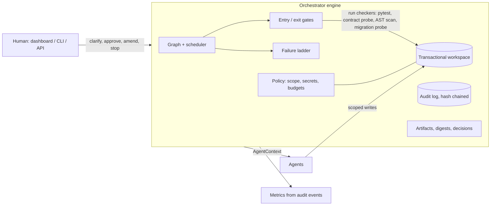
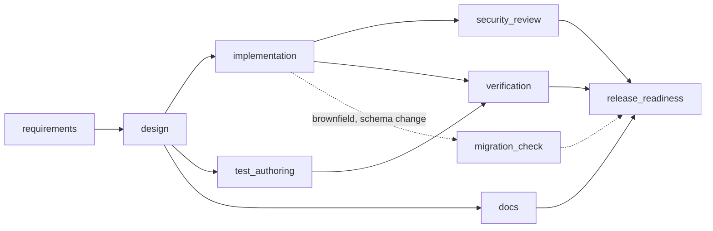

# Architecture

## Shape of the system

One process, one SQLite file (runs + audit events), one directory per run holding the workspace, its checkpoints, reports and the release bundle.

## The graph

Defined in `orchestrator/pipeline.py`. Edges are explicit data (`NodeSpec.deps`), serialised into each run, and can change while the run is in flight.

| Stage | Depends on | May write | Exit gates | Human |
|---|---|---|---|---|
| requirements | none | nothing | no_blocking_questions, spec_complete | clarification when ambiguous |
| design | requirements | nothing | design_complete, tasks_acyclic, risks_have_validation | approval when impact tags match policy |
| implementation | design | `shortener/**` | files_written, compiles, policy_clean, tasks_covered | none |
| test_authoring | design | `tests/**` | tests_traceable | none |
| docs | design | `docs/**`, `README.md` | docs_cover_contract | none |
| security_review | implementation | nothing | no_high_findings | none |
| verification | implementation, test_authoring | nothing | tests_pass, contract_conformance | none |
| migration_check *(dynamic)* | implementation | nothing | migration_ok | none |
| release_readiness | verification, security_review, docs (+ migration_check) | nothing | release_checklist | **always** |

`test_authoring` reads only the design contract, never the implementation, so the tests are an independent check rather than a description of the code.

## Execution

- **Dataflow scheduling.** A stage launches when every ancestor is `SUCCEEDED` and its entry gates pass. Independent stages go to a thread pool at once; the driver loop waits on `FIRST_COMPLETED` and re-evaluates after each, so a join stage starts the moment its last dependency lands. `tests/orch/test_orch_engine.py::test_independent_stages_really_run_in_parallel` proves the overlap with a three-way barrier that can only be passed if the stages run concurrently.
- **One lock per run.** State changes happen under it; agent work happens outside it.
- **Tokens.** Each launch gets a token. If a stage is invalidated or the run halts while it is running, its late result is recorded as `result_discarded` and never applied.
- **Restart safety.** State is saved to SQLite after every step. `Engine.recover()` (called at server start) rolls back any stage that was mid-flight and re-runs it.

## Gates: evidence versus decision

Checkers (the verification, security and migration agents) produce evidence: pytest results parsed from junit XML, an OpenAPI conformance probe against the generated app, an AST scan, a probe that opens a database created by the *baseline* code with the *new* code. They never say pass or fail. A named gate in `orchestrator/gates.py` reads the evidence and decides. Entry gates guard launch (`change_freeze_off`, `workspace_has_code`, `upstream_green`); exit gates guard acceptance. Every evaluation is an audit event.

## Failure ladder

Bounded at every rung. Budgets live on the node (`max_retries`, `max_rework`) and in `policy.json`.

| Failure | Response |
|---|---|
| Transient agent error or crash | Roll back the stage's writes, retry (default 2, backoff hook) |
| Retries spent and a fallback agent exists | Switch to the fallback agent |
| Exit gate fails | Roll back and **rework the responsible upstream stage** (`rework_target`), passing the failure as feedback; downstream stages are invalidated |
| Rework returns an identical artifact after feedback | `rework_futile`: stop spending budget, escalate to a human |
| Policy violation (scope, secret, protected path, size) | Write is refused before it touches disk; counts against a run-wide violation budget (3) |
| Agent refuses | Escalate immediately, no retry |
| Anything exhausted, deadline exceeded, human rejection or stop | Roll back, discard in-flight results, run goes `HALTED` (safe-stop). Nothing is released |

Rollback is a scope-aware checkpoint restore, so undoing one stage cannot touch files owned by a stage running in parallel.

## Context and decision lineage

- Each stage output is **content-addressed** (digest of canonical JSON). The digests of the inputs a stage launched with are recorded.
- A new output creates artifact `stage@n` recording exactly which upstream artifact versions it was built from (`inputs`).
- When an upstream digest changes, dependents are invalidated (`STALE`). When a re-run produces an **identical** digest the engine emits `output_unchanged` and stops there (early cutoff): the security review in the ambiguous scenario re-ran but did not force the release stage to redo its work.
- Agents emit **decision records** (`adr:*`, `answer:*`, `strategy`, …). A later record for the same key supersedes the earlier one; both stay on record with pointers. This is what lets you answer "why is it checking at redirect time?" with the reviewer amendment that overrode the first answer.

## Human checkpoints

| Checkpoint | Trigger | Actions |
|---|---|---|
| Clarification | Blocking open questions after requirements | answer (unsupported options are rejected with a note), or accept defaults |
| Design approval | Impact tags intersect `approval_required_tags` in policy | approve, reject, request changes |
| Release approval | Always | approve, reject, request changes |

An approval is bound to the **digest** of what was reviewed; if the artifact changed, the decision is refused. `request_changes` carries an amendment that is appended to the requirement, invalidating everything downstream so the whole chain re-plans. The release bundle (zip) is created only after approval.

## Guardrails

`policy.json`, enforced by `orchestrator/policy.py` and `workspace.py`, not by agent goodwill:

- **Write scope** per stage; path traversal refused.
- **Protected paths** (`Dockerfile`, `.github/**`, `requirements*.txt`, `pyproject.toml`, `policy.json`, `render.yaml`) cannot be written by any agent.
- **Secret scan** on every write (cloud keys, private keys, tokens, hardcoded credentials).
- **Compliance**: analytics must not persist raw IPs or other direct identifiers (checked by the security review against `pii_columns`).
- **Change control**: approval tags, `change_freeze` entry gate.
- **Budgets**: files and bytes per stage, violations per run, wall-clock per run (active time; human waiting is excluded).

## Observability

- **Audit log**: append-only `events` table; each row stores `hash = sha256(prev_hash + canonical(body))`, per run. `verify` detects edits, deletions and reordering. This is tamper *evidence*, not prevention: anyone who can rewrite the whole database can rewrite the chain. Anchoring the head hash somewhere external is the production fix.
- **Metrics** (`orchestrator/metrics.py`) are derived only from audit events, so every number can be traced to events: success rate, retry / rework / rollback / fallback counts and frequency (per stage execution), MTTR (stage `node_failed` to its next `node_succeeded`), end-to-end latency, active latency (minus human wait), human wait, per-stage time.

## Dynamic re-planning

Two mechanisms. (1) **Graph change**: after design completes, `apply_adjustments` inspects the impact tags; a `schema_change` in a brownfield run inserts `migration_check` and wires it into the release join (`graph_replanned` event). (2) **Requirement change**: an amendment or clarification invalidates `requirements`, and the invalidation rules above re-run exactly the affected stages.

## Agents

An agent is `run(ctx: AgentContext) -> AgentOutput` with a narrow write scope. It never decides whether its own output is acceptable. Shipped agents are deterministic: they select and parameterise reviewed packs in `catalog/` (core service, aliases and expiry, safer links), which is why scenarios are reproducible. Fault injection (`faults` on a run) makes an agent fail transiently, ship a seeded defect, or leak a credential.

### Swapping in an LLM

Register an object with `name` and `run(ctx)` under the same key (`default_registry()` in `orchestrator/agents/__init__.py`). `ctx.workspace` is already the policy-enforcing writer, `ctx.inputs` the upstream artifacts, `ctx.feedback` the failure to fix. Nothing in the engine, gates or policy changes; they are what makes an unreliable agent safe to run.

## HTTP surface

`orchestrator/api.py`: scenarios, runs, run detail, events, audit verify, metrics, artifacts, lineage, files, diff, engineering summary, release bundle; actions: start, clarify, approve, amend, stop. Actions need `X-Admin-Token` when `ADMIN_TOKEN` is set; starting runs is rate limited and capped.
